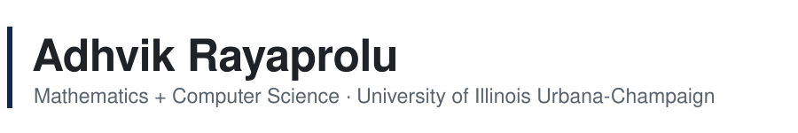

<picture>
  <source media="(prefers-color-scheme: dark)" srcset="./assets/banner-dark.svg">
  
</picture>

I study Mathematics and Computer Science at the University of Illinois Urbana-Champaign (Dean's List, expected May 2028). I build AI-powered products and full-stack applications, and I do research in digital health and sports statistics.

[LinkedIn](https://www.linkedin.com/in/adhvikrayaprolu) · [Email](mailto:adhvik.rayaprolu@gmail.com) · [Repositories](https://github.com/adhvikrayaprolu?tab=repositories)

## Experience

| Role | What I built |
|---|---|
| **AI Intern, [Gnani.ai](https://gnani.ai)** Jun 2026 to Aug 2026 · Bengaluru | [**AstroGnani**](https://github.com/adhvikrayaprolu/AstroGnani): a consumer astrology assistant with web chat and voice input. I built the backend conversation system, including turn planning, evidence-grounded answers, memory across sessions, and English and Hindi replies. Python, FastAPI, Azure OpenAI, MongoDB, Redis |
| **Undergraduate Researcher, NCSA SPIN** Aug 2026 to present · Info Access Lab · advised by Prof. Rachel Adler | [**mHealth for cancer survivors**](https://github.com/adhvikrayaprolu/ncsa-spin-research): building a health app co-designed with survivors that supports physical activity, cognitive health, and social connection, with consent-gated AI recommendations. React, TypeScript, Django, PostgreSQL, Docker |
| **Undergraduate Researcher, Illinois Mathematics Lab** Aug 2025 to present · advised by Prof. A.J. Hildebrand | [**Sports statistics research**](https://github.com/adhvikrayaprolu/iml-research): testing how well ESPN's live win probabilities are calibrated, after measuring how much of European soccer results comes from skill versus luck across 32,000+ matches ([code](https://github.com/adhvikrayaprolu/iml_skillvsluck)). Python, pandas, NumPy, SciPy |
| **Co-Founder and Developer, Zapp** Jan 2026 to Aug 2026 · Champaign | [**Zapp**](https://github.com/adhvikrayaprolu/Zapp): a personal-finance app that scores purchases against a user's own history and recommends what is worth keeping. Django, React, TypeScript, Supabase |
| **Software Engineering Intern, ClayHR** May 2025 to Jul 2025 · Remote | **GatherLink**: an interest-group community platform, built as a [web app](https://github.com/adhvikrayaprolu/gather-link-web-app) and an [Android app](https://github.com/adhvikrayaprolu/gather-link-mobile-app), plus an HR support chatbot prototype. Java, Spring Boot, Android, Firebase |

## Projects

| Project | Description |
|---|---|
| [**Illini SkillShare**](https://github.com/adhvikrayaprolu/uiuc-skillshare) | Matches UIUC students who can teach each other skills, with verified Illinois sign-in, ranked search, requests, and feedback. Django, React, TypeScript, PostgreSQL |
| [**Swave**](https://github.com/adhvikrayaprolu/swave) | Swipe-based music discovery: like or pass on song previews and build playlists from what you keep. CS 222 team project. Django, React, TypeScript |
| [**Persistent Chatbot**](https://github.com/adhvikrayaprolu/chatbot-app) | A Flask chatbot with separate, persistent conversations, an offline demo mode, and an optional OpenAI provider. Grew out of the ClayHR chatbot work. Python, Flask, SQLite |

## Skills

**Languages:** Python, Java, TypeScript, JavaScript, SQL, C/C++, R 
**AI:** LLM APIs, retrieval-augmented generation, conversational agents, speech-to-text 
**Backend and data:** FastAPI, Django REST Framework, Flask, Spring Boot, PostgreSQL, MongoDB, Supabase, Firebase 
**Frontend and tools:** React, Android, Docker, GitHub Actions, pandas, NumPy
